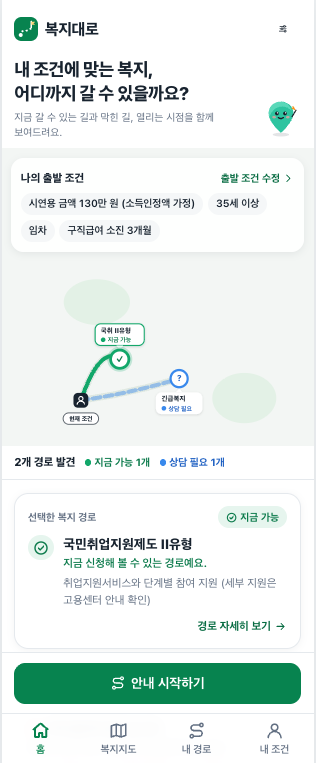
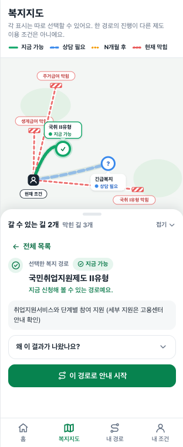

# 복지대로 | Bokji-Daero

### 복잡한 복지제도를, 누구나 따라갈 수 있는 길로.

**사회보장 데이터와 AI를 활용한 개인 맞춤형 복지 내비게이션 서비스**

복지대로는 단순히 받을 수 있는 복지제도를 나열하는 대신, 사용자의 현재 상황에서 **어떤 복지를 확인할 수 있고, 왜 추천되었으며, 다음에 무엇을 해야 하는지** 안내하는 서비스입니다.

복잡한 복지제도를 직관적인 경로로 시각화하고, 자격 확인부터 신청 준비까지의 과정을 단계별로 연결합니다.

> **탐색은 지도처럼, 신청은 내비게이션처럼, 진행 관리는 여정처럼.**

본 프로젝트는 「2026 사회보장 데이터를 활용한 AI 혁신 아이디어 경진대회」 출품을 위해 제작한 웹 프로토타입입니다.

현재 시연은 **실직한 1인 가구**를 중심으로 구성되어 있으며, 일부 복지제도의 판정은 시연용 규칙을 사용합니다. 서비스의 안내는 공식 자격 심사나 지원 결정을 대신하지 않습니다.

---

## 01. Project Overview

### 문제 정의

다양한 사회보장제도가 존재하지만, 사용자가 자신에게 필요한 복지제도를 발견하고 실제 신청까지 진행하는 과정은 여전히 복잡할 수 있습니다.

- **정보 탐색의 어려움:** 자신에게 해당하는 복지제도를 직접 찾아 비교해야 합니다.
- **자격 조건의 복잡성:** 소득, 재산, 연령, 가구 구성 등 다양한 기준을 이해해야 합니다.
- **신청 과정의 불확실성:** 어떤 서류를 준비하고 어디에서 신청해야 하는지 파악하기 어렵습니다.
- **정보와 행동의 단절:** 제도를 발견하더라도 실제 신청 준비까지 이어지지 않을 수 있습니다.

### 해결 방향

복지대로는 복지 정보를 사용자의 관점에서 재구성합니다.

**01 · Discover — 발견하기**

사용자의 조건을 바탕으로 관련 복지제도를 탐색하고, 각각의 선택지를 경로 형태로 보여줍니다.

**02 · Understand — 이해하기**

추천 이유, 충족되지 않은 조건, 추가 확인 사항을 이해하기 쉬운 형태로 제공합니다.

**03 · Navigate — 실행하기**

선택한 복지제도를 이용하기 위해 필요한 행동을 단계별로 안내합니다.

**04 · Continue — 이어가기**

사용자가 선택한 경로와 직접 기록한 진행 상태를 저장해, 다음 방문에서도 안내를 이어갈 수 있도록 합니다.

---

## 02. Key Features

### 01. 개인 맞춤형 복지 경로 탐색

사용자의 소득, 연령, 주거 및 구직급여 상태 등을 바탕으로 관련 복지제도를 탐색합니다.

추천 결과는 상태에 따라 구분됩니다.

- **지금 가능:** 시연 규칙상 현재 이용 가능성이 있는 경로
- **상담 필요:** 추가적인 조건이나 기관 확인이 필요한 경로
- **N개월 후:** 일정 기간 경과 후 재확인이 필요한 경로
- **막힌 길:** 현재 입력 조건에서 제한 또는 미충족 사유가 확인된 경로

각 복지제도는 독립적인 선택지로 표현됩니다. 지도상의 연결은 제도를 순서대로 신청해야 한다는 의미가 아닙니다.

### 02. 인터랙티브 복지지도

SVG 기반의 경로 시각화를 제공합니다.

- 출발 조건과 복지제도 간 관계 시각화
- 상태에 따른 경로 색상과 선 스타일
- 지도 노드와 하단 목록의 양방향 선택 연동
- 선택한 경로의 주요 정보와 판정 근거 확인
- 접힘·펼침이 가능한 바텀시트
- 반응형 지도 배치

지도를 사용하지 않아도 동일한 복지제도 정보를 목록으로 탐색할 수 있습니다.

### 03. 행동 중심의 복지 내비게이션

제도를 선택하면 단순한 정책 설명 대신 현재 필요한 행동부터 안내합니다.

- 자격 및 참여 제한 조건 확인
- 신청 준비사항 안내
- 공식 안내기관 확인
- 다음 행동과 안내 단계 표시
- 추천 이유 및 상세 정보 펼쳐보기

사용자가 직접 표시한 안내 기록과 공식 신청·접수·승인 상태는 별도로 구분합니다.

### 04. 조건 변경 및 복지 경로 재탐색

사용자의 상황 변화에 따라 추천 결과를 다시 계산합니다.

- 소득과 주거 조건 변경
- 구직급여 관련 상황 변경
- 조건 변경 전후 결과 비교
- 새로 나타난 경로 및 제외된 경로 확인
- 시간 경과에 따른 경로 미리 보기

미래 경로는 실제 신청 자격의 자동 취득을 보장하지 않습니다.

### 05. 공식 사회보장 데이터 검색

한국사회보장정보원의 공식 복지서비스 CSV를 활용한 검색 기능을 제공합니다.

**데이터 수집 현황**

| 항목 | 내용 |
|---|---|
| 데이터 제공기관 | 한국사회보장정보원 |
| 데이터명 | 복지서비스정보 |
| 원본 파일 기준일 | 2026.08.19 |
| 수집일 | 2026.11.03 |
| 정규화된 제도 수 | 461건 |
| 검색 경로 | `/official-data` |
| 수집 방식 | 공공데이터포털 CSV 다운로드 |

수집한 데이터는 제도명, 요약, 소관기관, 공식 상세 링크 등의 정보 제공에 사용됩니다.

**공식 카탈로그 검색과 개인별 자격 판정은 분리되어 있습니다.** CSV 요약만으로 신청 자격을 자동 판정하지 않습니다.

자세한 내용은 [DATA_SOURCES.md](./DATA_SOURCES.md)를 참고하세요.

---

## 03. Screenshots

주요 화면은 다음 네 가지로 구성됩니다.

| <br>**홈 · 현재 조건과 추천 경로** | <br>**복지지도 · 경로 탐색** |
|---|---|
| <br>**내 경로 · 단계별 행동 안내** | <br>**내 조건 · 조건 수정** |

---

## 04. AI Integration

### AI 기반 개인화 복지 안내

복지대로는 검증된 자격 판정의 근거를 생성형 AI가 쉽게 설명하도록 하는 구조를 구현하고 있습니다. 현재 공식 기준을 대조한 규칙 판정은 국민취업지원제도 I유형에 한정되며, 그 밖의 일부 추천 규칙은 시연용입니다. 서버 API와 응답 검증 코드는 준비되어 있지만, 실제 OpenAI 모델 호출은 아직 검증되지 않았습니다.

AI는 최종 자격을 직접 결정하지 않습니다.

**Rule-based Engine**

- 사용자 조건과 제도 기준 비교
- 충족·미충족·미확인 조건 구분
- 검증된 제도 범위 내 참여 제한 및 예외 조건 처리
- 판정 근거와 공식 출처 관리

**Generative AI**

- 판정 근거를 쉬운 언어로 설명하도록 구성
- 서버가 허용한 추가 확인 사항과 다음 행동 전달
- 복잡한 행정 용어 해석을 위한 확장 지점
- 실제 모델 응답과 사용자 이해도는 미검증

### Architecture

```text
Official Welfare Data
         │
         ▼
Data Collection & Normalization
         │
         ▼
Rule-based Eligibility Assessment
         │
         ├── Eligibility Status
         ├── Assessment Evidence
         └── Missing Information
                  │
                  ▼
         AI Explanation Layer
                  │
                  ▼
       Welfare Navigation UI
                  │
         ┌────────┴────────┐
         ▼                 ▼
   Route Discovery     Action Guidance
```

### 현재 구현 상태

AI 개인화 설명을 위한 서버 API와 구조화된 응답 검증 로직을 구현했습니다.

- 요청 데이터 검증
- 서버 측 자격 재판정
- OpenAI Structured Outputs 적용
- AI의 판정 상태 변경 제한
- 서버에서 관리하는 출처 및 행동 정보 사용
- 사용자 동의 후 최소 조건 전송
- 오류 발생 시 기존 규칙 기반 안내 유지

**현재 실제 OpenAI 모델 호출과 AI 응답 품질 평가는 검증되지 않았습니다.**

AI 설명을 활성화하려면 별도의 API 키 설정이 필요합니다. 키가 없는 환경에서도 복지 탐색과 규칙 기반 안내는 사용할 수 있습니다.

자세한 내용은 [AI_IMPLEMENTATION.md](./AI_IMPLEMENTATION.md)와 [AI_EVALUATION.md](./AI_EVALUATION.md)를 참고하세요.

---

## 05. Tech Stack

| Category | Technology |
|---|---|
| Framework | Next.js 16 · App Router |
| Language | TypeScript |
| Styling | Tailwind CSS 4 |
| Visualization | SVG |
| State Persistence | Browser localStorage |
| AI Interface | OpenAI API · Structured Outputs |
| Testing | Vitest |
| Data Processing | Node.js Scripts |
| Data Source | Public Welfare CSV |

별도의 사용자 로그인이나 데이터베이스 없이 동작하는 시연용 웹 프로토타입입니다.

---

## 06. Project Structure

```text
bokji-daero/
├── data/
│   ├── raw/               # 공식 데이터 원본
│   └── normalized/        # 정규화된 데이터
│
├── scripts/
│   ├── download-central-welfare-csv.mjs
│   └── import-welfare-csv.mjs
│
├── src/
│   ├── app/
│   │   ├── page.tsx       # 홈
│   │   ├── map/           # 복지지도
│   │   ├── route/         # 내 경로
│   │   ├── my/            # 내 조건
│   │   └── official-data/ # 공식 데이터 검색
│   │
│   ├── components/        # 공통 UI 및 지도 컴포넌트
│   │
│   └── lib/
│       ├── engine/        # 자격 판정 및 비교 로직
│       ├── data/          # 복지 데이터 모델
│       └── state/         # 상태 관리
│
├── DATA_SOURCES.md
├── ELIGIBILITY_ENGINE.md
├── AI_IMPLEMENTATION.md
├── AI_EVALUATION.md
└── README.md
```

실제 파일 구조는 개발 과정에서 변경될 수 있습니다.

---

## 07. Getting Started

### Requirements

- Node.js 20.9 이상
- npm

### Installation

```bash
git clone <repository-url>
cd bokji-daero
npm install
```

### Development

```bash
npm run dev
```

브라우저에서 다음 주소에 접속합니다.

http://localhost:3000

### Testing

```bash
npm test
npm run lint
```

### Production Build

```bash
npm run build
npm start
```

일부 제한된 개발 환경에서는 Turbopack 관련 프로세스 생성 및 포트 바인딩 오류가 발생할 수 있습니다.

해당 환경에서는 다음 Webpack 빌드 명령을 사용할 수 있습니다.

```bash
npm run build -- --webpack
```

### Environment Variables

AI 기능을 사용하는 경우 서버 환경변수를 설정합니다.

```env
OPENAI_API_KEY=
OPENAI_MODEL=
```

`OPENAI_MODEL`은 선택 설정입니다. 지원되는 설정과 자세한 내용은 `.env.example` 및 `AI_IMPLEMENTATION.md`를 참고하세요.

실제 API 키가 포함된 `.env.local` 파일은 Git에 커밋하지 마세요.

AI 키가 없는 환경에서도 주요 화면과 공식 복지 데이터 검색 기능은 동작합니다.

---

## 08. Demo Scenario

복지대로는 실직한 1인 가구를 중심으로 사용자 경험을 시연합니다.

### 기본 입력 조건

| 항목 | 시연 조건 |
|---|---|
| 가구 형태 | 1인 가구 |
| 연령 | 35세 이상 |
| 소득인정액 | 월 130만 원 추정 |
| 주거 형태 | 임차 |
| 구직급여 | 종료 후 3개월 |

### 시연 흐름

**STEP 01 — 복지 경로 발견**

홈에서 현재 조건에 따른 추천 경로를 확인합니다.

**STEP 02 — 경로 탐색**

복지지도에서 각 제도를 선택하고 상태, 추천 이유 및 제한 조건을 비교합니다.

**STEP 03 — 행동 안내**

관심 있는 제도를 선택하고 현재 필요한 확인 사항과 신청 준비 과정을 살펴봅니다.

**STEP 04 — 상황 변경**

구직급여 관련 상황이나 소득 조건을 변경하여 추천 결과가 어떻게 달라지는지 확인합니다.

**STEP 05 — 경로 재탐색**

새롭게 나타나거나 제외된 복지 경로를 확인하고 다른 선택지를 탐색합니다.

**STEP 06 — 안내 이어가기**

사용자가 직접 기록한 안내 상태를 바탕으로 이전에 선택한 경로를 다시 확인합니다.

언제든 내 조건 화면에서 기본 시나리오로 돌아갈 수 있습니다.

---

## 09. Accessibility & UX Principles

복지대로는 다양한 연령과 디지털 숙련도를 가진 사용자를 고려해 설계했습니다.

### 핵심 디자인 원칙

**Clarity**

복지제도의 정보량보다 사용자가 현재 이해하고 수행해야 할 행동을 우선합니다.

**Explainability**

단순한 추천 결과뿐 아니라 판단 근거와 추가 확인 조건을 제공합니다.

**Accessibility**

- 색상과 텍스트·아이콘을 함께 사용한 상태 표현
- 주요 조작 요소의 충분한 터치 영역
- 텍스트 대비를 고려한 색상 시스템
- SVG 지도 외 목록 기반 탐색 제공
- 모션 감소 설정 지원
- 화면 크기에 따른 반응형 레이아웃

**Continuity**

사용자가 선택한 경로와 안내 기록을 유지하여 중단한 지점에서 다시 확인할 수 있도록 합니다.

접근성 관련 설계 요소가 적용되어 있지만, 실제 다양한 사용자와 보조기술을 통한 접근성 검증은 추가로 필요합니다.

---

## 10. Privacy & Data Handling

이 프로젝트는 시연용 프로토타입이며 별도의 사용자 계정이나 데이터베이스를 사용하지 않습니다.

- 사용자 조건과 안내 기록은 기본적으로 브라우저 localStorage에 저장됩니다.
- 사용자는 내 조건 화면에서 관련 기록을 삭제할 수 있습니다.
- AI 설명은 사용자가 선택 동의한 경우에만 요청됩니다.
- AI 요청 시 선택한 제도에 필요한 최소 조건만 서버를 거쳐 외부 API로 전송합니다.
- 이름, 연락처, 주소 및 localStorage 전체는 AI 요청에 포함하지 않습니다.
- 앱 서버에서는 AI 요청·응답 내용을 별도로 저장하거나 애플리케이션 로그로 남기지 않도록 설계했습니다.

외부 AI 제공자의 데이터 처리 및 보관 정책은 별도로 적용될 수 있습니다.

현재 개인정보 보호 및 데이터 처리 구조는 시연 환경을 기준으로 설계했으며, 실제 서비스 운영 시 추가적인 법적·기술적 검토가 필요합니다.

---

## 11. Limitations & Future Work

### 현재 프로토타입의 한계

- 실직한 1인 가구 중심의 제한된 시나리오
- 일부 복지제도는 공식 검증 전 시연용 판정 규칙 사용
- 공식 CSV 전체를 개인별 자격 판정에 활용하지 않음
- 실제 소득인정액 자동 산정 미지원
- 제도별 모든 제한 조건 및 예외사항 미반영
- 공식 접수·심사·승인 시스템 미연동
- AI 모델 실호출 및 사용자 효과 검증 미완료
- 공식 CSV 데이터 자동 갱신 미구현

### 향후 발전 방향

**Phase 1 — 데이터 신뢰성 확대**

더 많은 복지제도의 공식 선정 기준과 신청 조건을 구조화하고 검증 범위를 확대합니다.

**Phase 2 — AI 개인화 안내 실증**

실제 생성형 AI 모델을 연결하고 추천 근거 설명, 추가 질문 및 행동 안내의 정확성과 이해도를 검증합니다.

**Phase 3 — 사용자 경험 검증**

복지제도 탐색 성공률, 추천 이유 이해도, 다음 행동 파악 성공률 등을 측정하여 UI/UX를 개선합니다.

**Phase 4 — 현장 적용 가능성 검토**

복지상담 현장 적용과 공식 안내기관 연계 가능성을 검토하고, 다양한 가구 유형과 지자체 복지제도로 확장합니다.

---

## 12. Documentation

프로젝트의 기술적 설계 및 데이터 활용 근거는 아래 문서에서 확인할 수 있습니다.

- [DATA_SOURCES.md](./DATA_SOURCES.md) — 공식 사회보장 데이터 출처 및 수집·정규화
- [ELIGIBILITY_ENGINE.md](./ELIGIBILITY_ENGINE.md) — 자격 판정 엔진과 판정 근거
- [AI_IMPLEMENTATION.md](./AI_IMPLEMENTATION.md) — AI 호출 구조, 검증 및 데이터 처리
- [AI_EVALUATION.md](./AI_EVALUATION.md) — AI 테스트 및 평가 현황
- [AI_INTEGRATION_PLAN.md](./AI_INTEGRATION_PLAN.md) — AI 활용 설계 및 확장 계획

---

## 13. Project Status

**Competition Prototype · 2026**

「2026 사회보장 데이터를 활용한 AI 혁신 아이디어 경진대회」 출품을 위한 아이디어 검증 및 시연 프로젝트입니다.

현재 핵심 UI/UX와 일부 규칙 기반 판정 기능, 공식 사회보장 데이터 검색 기능을 구현했습니다.

AI 기반 개인화 설명은 서버 연동 구조가 준비되어 있으나, 실제 모델 실행과 효과 검증은 후속 과제로 남아 있습니다.

본 프로젝트는 실제 복지서비스의 공식 신청 자격을 판정하거나 행정기관의 결정을 대신하는 서비스가 아닙니다.

---

**Bokji-Daero — 복지 정보를 넘어, 복지 이용의 길을 안내하다.**
